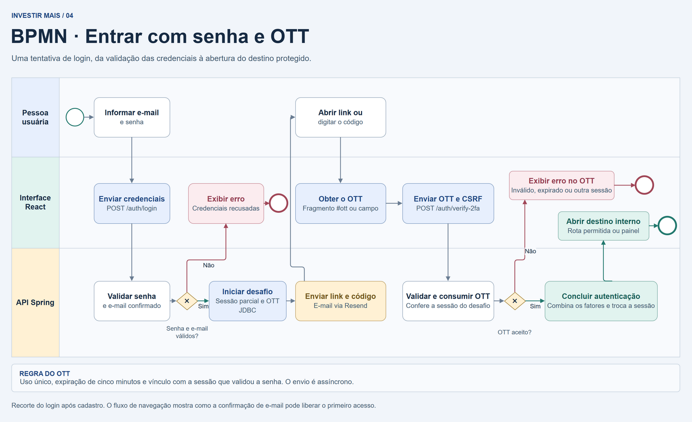
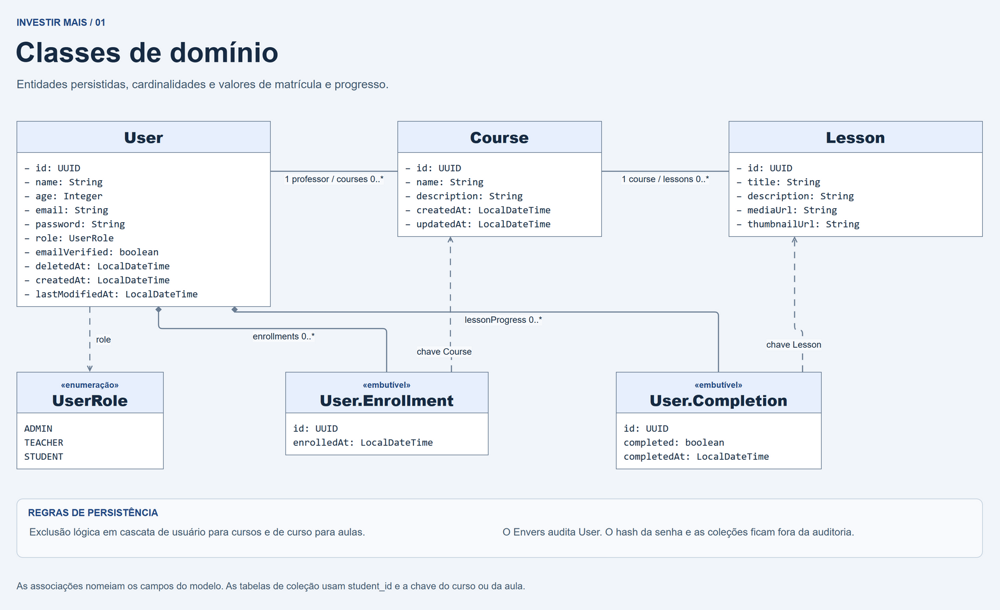

# Investir Mais

O Investir Mais é uma plataforma de educação financeira com catálogo de cursos e aulas. A aplicação reúne uma interface React e uma API Spring Boot. A gestão de carteira faz parte do escopo planejado.

[Diagramas](#diagramas) · [Execução local](#execução-local) · [API](#api) · [Testes](#testes-e-verificações) · [Frontend](frontend/investirMais/README.md) · [Privacidade](docs/lgpd/README.md)

## Funcionalidades

| Área | O que está disponível |
| --- | --- |
| Conta | Cadastro de aluno, confirmação de e-mail, login em duas etapas e recuperação de senha. A tela de perfil permite alterar o nome com a senha atual. |
| Painel | Entrada comum aos três perfis, com cursos em destaque e métricas para professores e administradores. |
| Educação | Catálogo paginado, navegação por curso e aula, reprodução de vídeos do YouTube e ações de gestão conforme o perfil. |

| Perfil | Consultar cursos e aulas | Criar cursos | Gerenciar cursos e aulas |
| --- | --- | --- | --- |
| `STUDENT` | Sim | — | — |
| `TEACHER` | Sim | Sim | Cursos próprios e suas aulas |
| `ADMIN` | Sim | Sim | Todo o catálogo |

O cadastro público aceita apenas `STUDENT`. A interface exibe as ações disponíveis e a API valida o perfil e a propriedade do curso em cada operação de escrita.

## Arquitetura

| Componente | Responsabilidade |
| --- | --- |
| React e React Router | Rotas públicas e protegidas, formulários, painel, catálogo, aula e perfil. |
| Axios e Orval | Axios centraliza cookies, CSRF e tratamento de falhas. Orval gera o cliente de educação a partir do contrato OpenAPI versionado. |
| Spring Boot e Spring Security | Endpoints HTTP, validação, autorização, autenticação com senha e OTT e regras de conta e educação. |
| PostgreSQL | Usuários, cursos, aulas, revisões Envers, tokens de uso único e registro de eventos de e-mail. |
| Redis | Sessões indexadas por usuário e contadores de tentativas de autenticação. |
| Resend | Entrega dos e-mails de confirmação, login e recuperação. |
| YouTube | Hospeda os vídeos referenciados pelas aulas. |

| Stack | Versões e referências |
| --- | --- |
| Backend | Java 21, Spring Boot 4.1.2, Spring Modulith 2.1.1, MapStruct 1.6.3 e SpringDoc 3.1.1. [Configuração Maven](pom.xml) |
| Frontend | Node.js 24 na CI, React 19.3.1, React Router 8.5.1, Vite 8.3.5, Tailwind CSS 4.3.4 e Orval 8.46.0. [Dependências travadas](frontend/investirMais/package-lock.json) |
| Infraestrutura de integração | PostgreSQL 17 e Redis 8 nos testes com Testcontainers. [Configuração da aplicação](src/main/resources/application.properties) |

```text
INVESTIR-MAIS/
├── .github/workflows/        Verificações de backend e frontend
├── docs/                     Diagramas, auditoria e notas de privacidade
├── frontend/investirMais/    SPA React e contrato OpenAPI de educação
├── src/main/java/com/repositorio/investir_mais/
│   ├── domain/               Conta, usuários, cursos e aulas
│   └── infrastructure/       Segurança e e-mail
├── src/main/resources/       Configuração e SQL de inicialização
├── src/test/                 Testes unitários, HTTP e de integração
├── .env.example              Modelo de configuração local do backend
└── pom.xml                   Build Maven
```

## Diagramas

Os diagramas do domínio e do login podem ser abertos em tamanho original. A [documentação da arquitetura](docs/diagrama-de-classes.md) relaciona cada visão ao código.

### Fluxo de navegação

- O cadastro público cria uma conta de aluno. Ao confirmar o e-mail original no navegador do cadastro, o usuário entra no painel. Em outro navegador, ou com um link reenviado, a página confirma a conta e oferece o login. A recuperação usa um código separado para definir a nova senha.
- Uma rota protegida verifica a sessão com `GET /auth/me`. Sem acesso, o React redireciona ao login e guarda a rota solicitada. Após os dois fatores, o navegador abre um destino interno permitido ou o painel.
- A área autenticada oferece painel, catálogo, curso, aula e perfil. Professor e administrador veem ações de gestão conforme suas permissões. A saída encerra a sessão no backend.

### BPMN do login com senha e OTT

1. A pessoa informa e-mail e senha. O Spring valida as credenciais e exige e-mail confirmado. Nessa etapa existe uma sessão parcial.
2. O serviço JDBC de OTT do Spring Security gera um token de uso único com validade de cinco minutos. O e-mail inclui o link **Concluir acesso** e a opção de digitar o código.
3. Na rota `/entrar/link`, o React lê e remove o token do fragmento da URL e o envia com CSRF para `POST /auth/verify-2fa`. O código manual chama o mesmo endpoint. O token pertence à sessão que iniciou o login e deve ser usado no mesmo navegador.
4. Após validar e consumir o OTT, o Spring combina os fatores e troca o identificador da sessão. O diagrama também mostra as saídas de recusa por credenciais ou token inválido.

[](docs/diagramas/bpmn-login-ott.png)

### Classes de domínio

- `User` representa a conta e seu perfil `UserRole`. A senha é persistida como hash Argon2id e fica fora das revisões Envers.
- Cada `Course` tem um usuário proprietário e pode ter zero ou mais aulas. Cada `Lesson` pertence a exatamente um curso e guarda os endereços de mídia e miniatura.
- A exclusão é lógica. Excluir um curso propaga a exclusão às aulas. Excluir uma conta pelo serviço também exclui logicamente os cursos e aulas vinculados.

[](docs/diagramas/classes-de-dominio.png)

### Classes da aplicação

- Na área de conta, `UserController` e `AuthenticationController` expõem operações de usuário e sessão. `UserService` concentra as regras da conta e usa `AccountSecurityService` para tokens de confirmação e recuperação e para revogação de sessões.
- No catálogo, controllers chamam `CourseService` e `LessonService`. Os serviços aplicam regras de permissão e propriedade, usam repositórios JPA e mapeiam entidades para DTOs com MapStruct.
- O `AuthenticationEmailHandler` envia os e-mails transacionais pela API do Resend.

## Execução local

### Pré-requisitos

- Git, JDK 21 e Node.js 24 com npm. O Maven Wrapper está no repositório.
- PostgreSQL e Redis em execução. Docker é uma opção para iniciar os serviços locais e é usado pelos testes de integração.
- Resend configurado para enviar confirmação de cadastro, link de login e código de recuperação. Use uma caixa de e-mail à qual tenha acesso.

### 1. Baixar o projeto e iniciar os serviços

```bash
git clone https://github.com/GabrielYYM/INVESTIR-MAIS.git
cd INVESTIR-MAIS
```

Se já houver PostgreSQL e Redis disponíveis, configure seus endereços no passo seguinte. Para criar containers locais, com acesso restrito à máquina:

```bash
docker run -d --name investir-mais-postgres -p 127.0.0.1:5432:5432 -e POSTGRES_DB=investir_mais -e POSTGRES_USER=postgres -e POSTGRES_PASSWORD=admin -v investir-mais-postgres:/var/lib/postgresql/data postgres:17-alpine
docker run -d --name investir-mais-redis -p 127.0.0.1:6379:6379 -v investir-mais-redis:/data redis:8-alpine redis-server --appendonly yes
docker exec investir-mais-postgres pg_isready -U postgres -d investir_mais
docker exec investir-mais-redis redis-cli PING
```

A senha `admin` acima é exclusiva do exemplo local. Após a criação, use `docker start investir-mais-postgres investir-mais-redis` para iniciar os mesmos containers.

### 2. Configurar e executar o backend

Copie [`.env.example`](.env.example) para `.env` na raiz e substitua os valores de exemplo. Para usar o PostgreSQL dos comandos acima, configure `DB_URL=jdbc:postgresql://localhost:5432/investir_mais`, `DB_USERNAME=postgres` e `DB_PASSWORD=admin`. Variáveis também podem ser fornecidas no ambiente do processo.

| Variáveis | Uso local |
| --- | --- |
| `DB_URL`, `DB_USERNAME`, `DB_PASSWORD` | Acesso ao PostgreSQL. |
| `REDIS_HOST`, `REDIS_PORT` | Padrão `localhost:6379`. Configure usuário, senha e TLS se o Redis exigir. |
| `RESEND_API_KEY`, `RESEND_FROM` | Chave da API e endereço de remetente de um domínio verificado no Resend. Ambas são obrigatórias no backend. |
| `APP_PUBLIC_BASE_URL` | Origem pública do backend. Padrão `http://localhost:8080`. |
| `APP_CORS_ALLOWED_ORIGIN` | Origem da SPA e base dos links de confirmação e login. Padrão `http://localhost:5173`. |
| `SESSION_TIMEOUT` | Limite de inatividade da sessão. Padrão `30m`. |

No PowerShell:

```powershell
if (-not (Test-Path -LiteralPath .env)) { Copy-Item .env.example .env }
# Edite .env com os dados locais antes de iniciar.
.\mvnw.cmd spring-boot:run
```

No Linux ou macOS:

```bash
test -e .env || cp .env.example .env
# Edite .env com os dados locais antes de iniciar.
bash mvnw spring-boot:run
```

O backend sobe em [localhost:8080](http://localhost:8080) com perfil `dev` por padrão.

### 3. Executar o frontend

Em outro terminal, a partir da raiz:

```bash
cd frontend/investirMais
npm ci
npm run dev
```

Abra [localhost:5173](http://localhost:5173). O proxy do Vite encaminha `/api`, `/auth` e `/csrf` para o backend. Para testar o acesso, cadastre um aluno, confirme o e-mail e entre com a senha. Abra **Concluir acesso** no mesmo navegador ou use o código manual. Veja opções de build, rotas e contrato no [README do frontend](frontend/investirMais/README.md).

## API

No perfil `dev`, o Swagger UI fica em [localhost:8080/swagger-ui.html](http://localhost:8080/swagger-ui.html) e a descrição OpenAPI em [localhost:8080/v3/api-docs](http://localhost:8080/v3/api-docs). Os endpoints de login, OTT e logout pertencem aos filtros de segurança.

| Endpoint ou grupo | Responsabilidade |
| --- | --- |
| `GET /csrf` | Disponibiliza o token CSRF para operações de escrita. |
| `POST /auth/login`, `POST /auth/code`, `POST /auth/verify-2fa` | Início por senha, reenvio na sessão parcial e confirmação do OTT. Login e verificação usam parâmetros de formulário. |
| `GET /auth/me`, `POST /auth/logout` | Identifica o usuário com sessão completa e encerra a sessão. |
| `/api/users` | Cadastro, verificação de e-mail, reenvio, recuperação e operações da própria conta. |
| `/api/courses` | Listagem paginada, detalhe, filtro por professor e gestão de cursos. |
| `/api/lessons` | Aulas por curso, detalhe e operações de gestão. |

### Sessões, dados e operação

- O cookie `SESSION` é `HttpOnly` e usa `SameSite=Lax`. O cliente consulta `/csrf` para preparar escritas, inclusive quando o token é renovado entre etapas da autenticação.
- O Redis indexa sessões por usuário para revogá-las após alterações de senha ou e-mail e após exclusão de conta.
- O limite de autenticação usa Redis por IP e rota e também por conta em `/auth/login`. O padrão é 10 solicitações por janela de um minuto. O limite retorna `429` com `Retry-After`. Se o Redis estiver indisponível, o filtro retorna `503`.
- Tokens de login usam `one_time_tokens`. Tokens de confirmação e recuperação ficam em `app_one_time_token`, com hash SHA-256 para novas emissões e consumo transacional. O Spring Modulith registra e reprocessa eventos de confirmação e recuperação. O e-mail de login segue o fluxo assíncrono da autenticação.
- A API exige a senha atual para excluir a própria conta. A exclusão lógica preserva o registro e mantém seu e-mail reservado. As operações do serviço cuidam da cascata e da revogação de acesso.

### Produção

Use o perfil `prod` com PostgreSQL, Redis e HTTPS. Configure `RESEND_API_KEY` e `RESEND_FROM` no ambiente do backend. O remetente deve pertencer a um domínio verificado. [Documentação do Resend](https://resend.com/docs/introduction)

Configure `APP_PUBLIC_BASE_URL` como a origem pública do backend e `APP_CORS_ALLOWED_ORIGIN` como a origem pública da SPA quando forem diferentes. O perfil ativa cookies `Secure`, habilita TLS no Redis por padrão e desativa Swagger e `/v3/api-docs`.

O esquema das entidades usa `ddl-auto=update` e o SQL auxiliar fica em [`schema-postgresql.sql`](src/main/resources/schema-postgresql.sql). As opções de publicação da SPA e do proxy estão no [README do frontend](frontend/investirMais/README.md#publicação).

## Testes e verificações

| Verificação | Comando |
| --- | --- |
| Backend no Windows | `.\mvnw.cmd -B verify` na raiz |
| Backend no Linux ou macOS | `bash mvnw -B verify` na raiz |
| Build do frontend | `npm ci` e `npm run build` em `frontend/investirMais` |
| Auditoria de dependências npm | `npm audit --audit-level=high` em `frontend/investirMais` |

A suíte inclui testes do fluxo de login com H2 e Redis simulado, além de testes de integração com PostgreSQL e Redis via Docker. Os testes com Testcontainers configurados com `disabledWithoutDocker` são ignorados quando Docker está indisponível. O [workflow de CI](.github/workflows/checks.yml) executa as verificações em pushes e pull requests.

## Documentação complementar

- [Frontend, rotas e publicação](frontend/investirMais/README.md)
- [Diagramas e referências ao código](docs/diagrama-de-classes.md)
- [Auditoria histórica de frontend e segurança](docs/auditoria-frontend-seguranca.md)
- [Privacidade e dados pessoais](docs/lgpd/README.md)
- [Licença](LICENSE)
