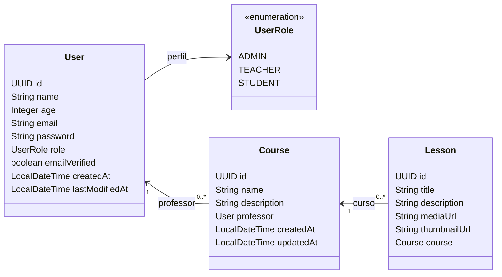

# Modelo atual do backend

Este diagrama foi conferido com as entidades de `src/main/java`. Ele cobre os domínios implementados atualmente (`user` e `education`); carteira, ativos e questões não possuem entidades/serviços no backend atual.

## Serviços e persistência

- `UserService` aplica regras de cadastro, perfil, verificação de e-mail e recuperação de senha. Usa `UserRepository`, `UserMapper`, `PasswordEncoder`, `OneTimeTokenService` e serviços de envio de e-mail.
- `CourseService` e `LessonService` implementam operações paginadas e verificam a propriedade do conteúdo antes de atualizá-lo ou removê-lo.
- Repositórios usam Spring Data JPA. As entidades `User` e `Course` têm campos temporais de auditoria; `User` também usa Hibernate Envers.
- A autenticação e a integração de cotações são componentes de infraestrutura, não entidades do modelo: consulte `ApplicationSecurityConfiguration`, `OAuth2AuthorizationServerConfig`, `BrapiClientConfiguration` e `BrapiQuoteController`.
