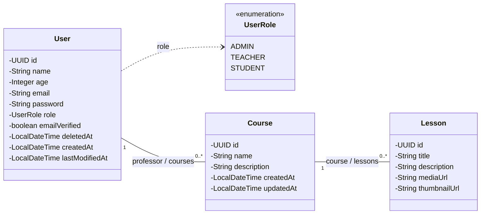

# Diagramas do Investir Mais

Os diagramas descrevem a implementação atual do projeto. As quatro imagens também aparecem no [README principal](../README.md#diagramas).

| Diagrama | O que mostra |
| --- | --- |
| [Classes de domínio](diagramas/classes-de-dominio.png) | Entidades JPA, atributos, multiplicidades e regras de persistência. |
| [Classes da aplicação](diagramas/classes-da-aplicacao.png) | Controllers, serviços, repositórios, mapeadores e dependências principais do backend. |
| [Fluxo de navegação](diagramas/fluxo-de-navegacao.png) | Acesso à conta, painel, cotações, catálogo, aulas, perfil e saída. |
| [BPMN de acesso](diagramas/bpmn-login-ott.png) | Uma tentativa de login com senha e token de uso único (OTT). |

O diagrama de acesso usa BPMN 2.0 para documentar o processo. [Especificação BPMN 2.0.2 da OMG](https://www.omg.org/spec/BPMN/2.0.2/)

## Classes de domínio

Cada curso referencia um usuário proprietário. Cada aula referencia um curso. A exclusão lógica se propaga de usuário para cursos e de curso para aulas. A senha é armazenada como hash Argon2 e fica fora da auditoria do Hibernate Envers. [User](../src/main/java/com/repositorio/investir_mais/domain/user/model/User.java), [Course](../src/main/java/com/repositorio/investir_mais/domain/education/model/Course.java), [Lesson](../src/main/java/com/repositorio/investir_mais/domain/education/model/Lesson.java)

## Navegação e permissões

O React Router consulta `/auth/me` antes de liberar a área protegida. Em caso de sessão ausente ou incompleta, a interface redireciona para o login com a rota de retorno. Após o OTT, abre o destino interno permitido ou o painel padrão. O cadastro público cria contas de aluno e exige confirmação de e-mail. [Rotas React](../frontend/investirMais/src/App.jsx), [Tela de login](../frontend/investirMais/src/pages/Login.jsx), [UserService](../src/main/java/com/repositorio/investir_mais/domain/user/service/UserService.java)

| Perfil | O que pode fazer no catálogo |
| --- | --- |
| Aluno (`STUDENT`) | Consultar cursos e abrir aulas. |
| Professor (`TEACHER`) | Consultar o catálogo, criar cursos e gerenciar os próprios cursos e suas aulas. |
| Admin (`ADMIN`) | Consultar o catálogo, criar cursos e gerenciar os cursos e aulas de qualquer proprietário. |

Os três perfis usam o mesmo painel. A interface exibe as ações de acordo com o perfil e a propriedade, e o backend aplica as mesmas verificações nas operações de escrita. [Ações do catálogo](../frontend/investirMais/src/services/educationData.js), [CourseService](../src/main/java/com/repositorio/investir_mais/domain/education/service/CourseService.java), [LessonService](../src/main/java/com/repositorio/investir_mais/domain/education/service/LessonService.java)

## Processo de acesso com OTT

O BPMN usa três raias para mostrar as responsabilidades da pessoa usuária, do React e da API Spring. A API valida a senha e o e-mail verificado, registra o desafio na sessão parcial e dispara o envio de um link e um código por e-mail. A pessoa abre o link no navegador em que começou o login ou informa o código na tela. As duas opções chamam `POST /auth/verify-2fa` com proteção CSRF. O Spring consome o token válido, conclui a autenticação e troca o identificador da sessão. [SecurityConfig](../src/main/java/com/repositorio/investir_mais/infrastructure/SecurityConfig.java), [AuthenticationEmailHandler](../src/main/java/com/repositorio/investir_mais/infrastructure/AuthenticationEmailHandler.java), [Login.jsx](../frontend/investirMais/src/pages/Login.jsx)

O recorte termina quando o acesso é concluído ou quando as credenciais ou o OTT são recusados. A etapa de abertura pressupõe que a mensagem chegou. Cadastro, confirmação de e-mail e redefinição de senha aparecem no fluxo de navegação e usam regras próprias.
