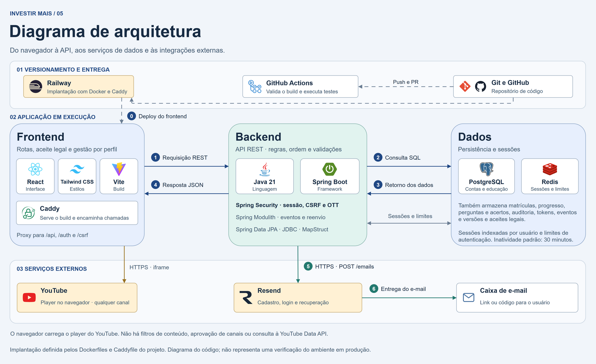
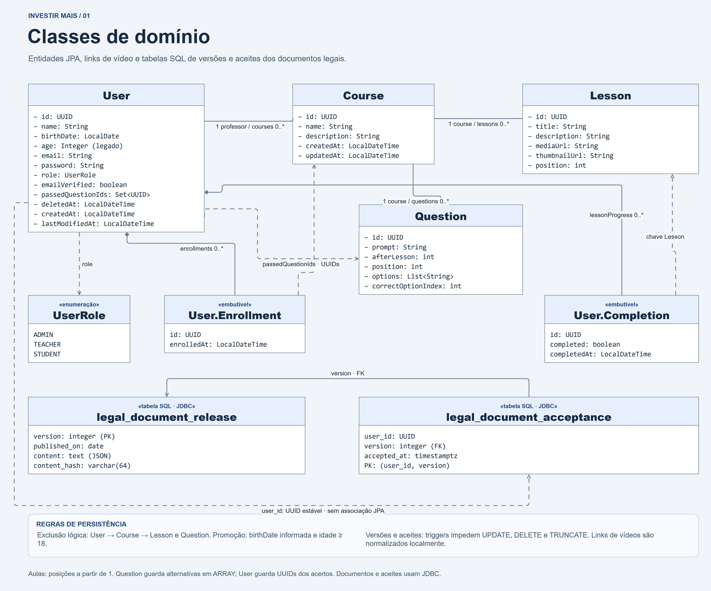
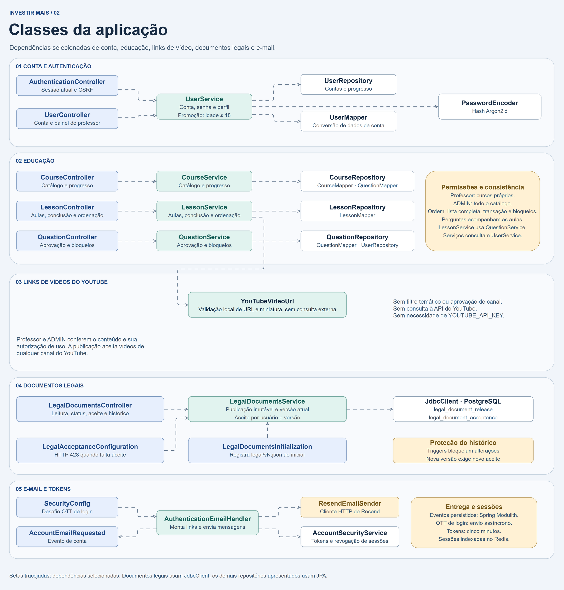
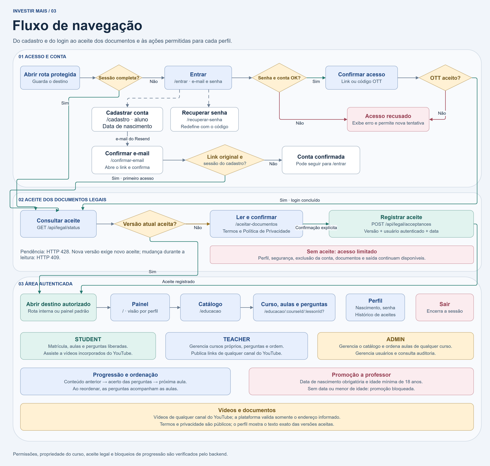
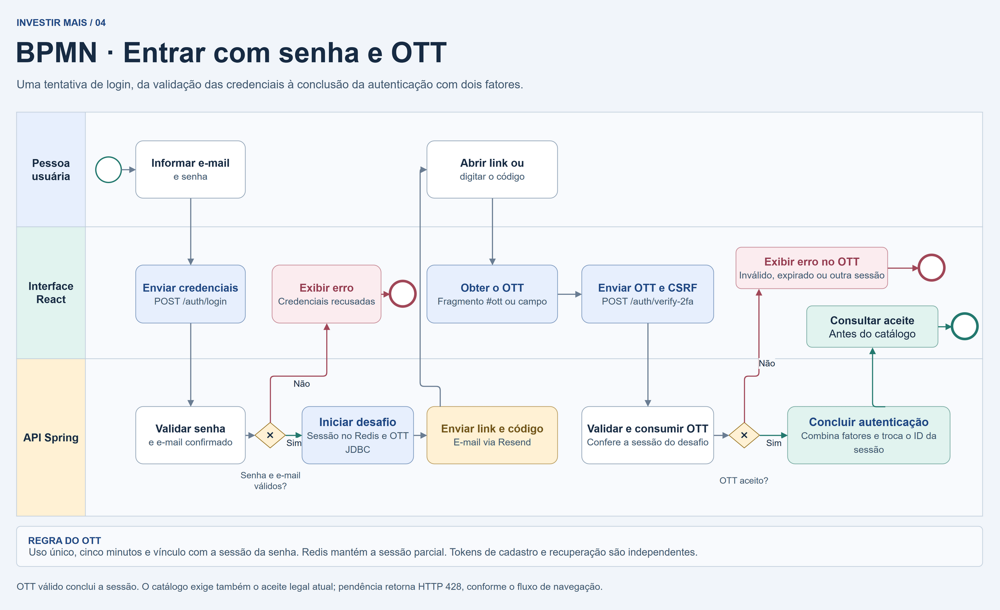

> Documento acadêmico em elaboração. Revisão técnica de 15/11/2026: conta e educação estão implementadas; gestão patrimonial e cotações permanecem propostas. Fontes acadêmicas, formatação e paginação exigem revisão própria antes da entrega. Veja o [índice técnico](README.md) e o [roteiro da apresentação](apresentacao.md).

UNIVERSIDADE DE MOGI DAS CRUZES
BACHARELADO EM ENGENHARIA DE SOFTWARE

FELIPE SEIJI NAMIYAMA NISHINA 
GABRIEL YUKIO YAMAGUTI MINATO 
LUCAS DO NASCIMENTO LIMA 

PLATAFORMA DE EDUCAÇÃO FINANCEIRA E GESTÃO PATRIMONIAL 

Mogi das Cruzes
2026
 FELIPE SEIJI NAMIYAMA NISHINA 
GABRIEL YUKIO YAMAGUTI MINATO 
LUCAS DO NASCIMENTO LIMA 

PLATAFORMA DE EDUCAÇÃO FINANCEIRA E GESTÃO PATRIMONIAL 

Trabalho desenvolvido para finalização do curso de Bacharelado em Engenharia de Software da Universidade de Mogi das Cruzes, sob orientação do Prof. Alessandro Aparecido da Silva Horas e coorientação do Prof. Leandro Almeida, contendo software e documentação de Projeto de Final de Curso para a obtenção de título de Bacharel em Engenharia de Software.

Mogi das Cruzes
2026
 RESUMO
O Investir Mais é uma plataforma web de educação financeira que organiza cursos, videoaulas do YouTube e perguntas de múltipla escolha em uma sequência de aprendizagem. O frontend React consome uma API Java 21 com Spring Boot. PostgreSQL mantém os dados educacionais, os registros de conta e as versões e aceites dos documentos legais; Redis mantém sessões e limites de autenticação. O aluno matriculado avança mediante conclusão das aulas anteriores e aprovação nas perguntas. Professores gerenciam os próprios cursos e administradores podem gerenciar todo o catálogo. Os vídeos permanecem hospedados no YouTube, com validação local do formato dos links. O projeto inclui testes automatizados de backend e frontend. A gestão patrimonial permanece planejada e não integra a versão descrita. Este texto descreve a implementação, sem apresentar resultados de avaliação pedagógica ou comprovação de conformidade jurídica.
Palavras-chave: educação financeira; plataforma educacional; cursos; aplicações web; progressão de aprendizagem.

 ABSTRACT
Investir Mais is a financial education web platform that organizes courses, YouTube video lessons and multiple-choice questions into a learning sequence. Its React frontend consumes a Java 21 API built with Spring Boot. PostgreSQL stores educational and account data, as well as legal-document versions and acceptance records; Redis stores sessions and authentication rate limits. Enrolled students advance by completing earlier lessons and passing questions. Teachers manage their own courses, while administrators can manage the entire catalog. Videos remain hosted on YouTube, with local validation of link format. The project includes automated backend and frontend tests. Portfolio management remains planned and is outside the version described here. This text describes the implementation without claiming measured educational outcomes or legal compliance.
Keywords: financial education; educational platform; courses; web applications; learning progression.

 
LISTA DE FIGURAS
Figura 1 - Diagrama de arquitetura
Figura 2 - Classes de domínio
Figura 3 - Classes da aplicação
Figura 4 - Fluxo de navegação
Figura 5 - BPMN do login com senha e OTT

 SUMÁRIO
1. Introdução e objetivos
2. Tecnologias e ferramentas
3. Análise e projeto: requisitos implementados
4. Segurança e conformidade: controles e limitações
5. Justificativas das funcionalidades educacionais
6. Referências bibliográficas

1.	INTRODUÇÃO
Segundo a CNN, a educação financeira infantojuvenil contribui para desenvolver adultos com hábitos financeiros saudáveis, fazendo com que esse tema seja essencial para a sociedade. Porém, o relatório do PISA 2022 aponta que cerca de 45% dos estudantes no Brasil não atingem o nível básico de proficiência em letramento financeiro, mostrando uma clara carência na formação escolar nessa área. Diante disso, o projeto vem como uma solução para melhorar esse cenário: uma plataforma de organização de links de videoaulas sobre o tema, a fim de conectar docentes da área com crianças e adolescentes interessados, além de ter ferramentas para auxiliar no aprendizado e na compreensão dos conteúdos das aulas.
1.1. Objetivos
-	Educação financeira infantojuvenil na sociedade;
-	Conectar docentes da área financeira, com crianças e adolescentes;
-	Planejar uma evolução com gestão patrimonial, ainda fora da implementação atual.
1.1.1. Objetivo Geral
Uma plataforma de aulas focada na educação financeira infantojuvenil com conteúdo simples e didático, podendo usar as ferramentas na plataforma para auxiliar nas aulas.
1.1.2. Objetivos Específicos
Como objetivos específicos deste trabalho foram elaboradas as seguintes ênfases:
•	Sistema de criação de modelos de aulas
•	Cadastro de links de videoaulas hospedadas no YouTube
•	Sistema de criação de conteúdos e lições
•	Elaboração de ferramentas para auxiliar nas aulas
•	Interface web responsiva. 
•	Acessibilidade para navegação por teclado e leitores de tela 

1.2. Justificativa
A falta da educação financeira infantojuvenil nas escolas tem gerado uma geração de adultos com cada vez mais complicações financeiras. Diante desse cenário, o projeto vem atender essa demanda através de uma plataforma de ensino por trazer racionalidade ao uso dos recursos em um momento em que as pessoas estão consumindo mais e tomando decisões de compras impulsivas, aprender técnicas de controle do próprio dinheiro.
Nesse sentido, utilizasse tecnologias confiáveis e amplamente aceitas pelo mercado de software o Java, devido à alta portabilidade, segurança e robustez em aplicações tanto em pequena, quanto em grande escala, além do PostgreSQL, pois por quase 40 anos, é conhecido como um dos bancos de dados relacionais mais avançados e confiáveis de código aberto.
2.	TECNOLOGIAS E FERRAMENTAS
2.1. Front-End
A responsividade ao usuário foi o foco do front-end. Em razão disso, utilizou-se o React, pois "o React permite construir interfaces de usuário a partir de peças individuais chamadas componentes" (META, 2026), além do Tailwind CSS, devido à sua alta customização e responsividade. Segundo sua documentação, o Tailwind é um framework CSS utility-first para a construção rápida de interfaces de usuário personalizadas (TAILWIND LABS, 2026), atuando em conjunto com o HTML e o CSS para garantir consistência, responsividade e manutenibilidade.
2.2. Back-End
A utilização de tecnologias confiáveis e amplamente aceitas pelo mercado foi o foco no back-end. Por essa razão, utilizou-se o Java, visto que ele apresenta a alta portabilidade, segurança e robustez necessários para aplicações tanto em pequena quanto em grande escala (ORACLE, 2026). Além disso, adotou-se o framework Spring Boot, pois "o Spring Boot simplifica a criação de aplicações autônomas e de nível de produção ao favorecer a convenção sobre a configuração, o que reduz a complexidade técnica e assegura a modularidade das camadas do sistema" (SPRING, 2026).
2.3. Banco de Dados
O PostgreSQL foi o SGBD relacional adotado no projeto, garantindo integridade indispensável, alta confiabilidade, suporte a consultas complexas e perfeita integração com o back-end. Segundo sua documentação oficial (POSTGRESQL, 2026), o sistema destaca-se por sua arquitetura comprovada, forte conformidade com o padrão SQL e tolerância a falhas, o que assegura a persistência e a consistência rigorosa das informações financeiras tratadas no sistema.
2.4. Apis a Consumir
A implementação utiliza Resend para e-mails transacionais. O navegador carrega o player do YouTube; o backend valida e normaliza o link sem consultar a YouTube Data API. A integração com Brapi e a carteira de investimentos permanecem planejadas e não estão presentes no código atual.
2.5. API Própria
O projeto usa o padrão REST para a integração entre o frontend e o backend. tendo interoperabilidade, escalabilidade e baixo acoplamento. Os principais endpoints gerenciam autenticação, perfis de usuários, cursos, aulas, perguntas, progresso e documentos legais, promovendo uma comunicação padronizada, eficiente e segura entre as camadas.
2.6. Versionamento E Colaboração
Para o versionamento do projeto foi utilizado o Git e Github, tendo em vista que pull requests com revisão para integrações e issues vinculadas ao GitHub que reúne ferramentas e fluxos de trabalho essenciais para todas as etapas do ciclo de vida do software (GITHUB, 2026), além do histórico e dados de alterações e eficiência em um software mantido por múltiplos contribuintes.
2.7. Deploy 
Os arquivos de implantação definem um backend Spring Boot e uma SPA compilada com Vite e servida pelo Caddy, que também encaminha as rotas da API. PostgreSQL, Redis e as credenciais do Resend são configurados no ambiente. Essa descrição dos arquivos não atesta os provedores ou o estado atual da produção.
2.8. Teste e Qualidade 
Para validar os testes unitários e qualidade do projeto foi utilizado o JUnit 5 e spring-boot-starter-test, validando as regras de negócio e integridade.
2.9. Segurança e Lgpd
A aplicação usa Spring Security com senha e OTT por e-mail, sessão no Redis, CSRF e hash Argon2id. As versões dos Termos e da Política de Privacidade e seus aceites são persistidas no PostgreSQL, com histórico imutável e nova confirmação a cada versão. Não há JWT, criptografia AES-GCM de campos pessoais ou fluxo de consentimento parental implementado. Esses controles não comprovam conformidade integral com a LGPD; o [estado técnico de privacidade](lgpd/README.md) registra os limites conhecidos.
2.10. Outras Tecnologias
O Maven e o NPM são ferramentas essenciais de build e gerenciamento de dependências. O Maven é utilizado para bibliotecas do Java no backend, já o NPM gere pacotes do React.

### Figura 1 — Arquitetura

### Figura 2 — Classes de domínio

### Figura 3 — Classes da aplicação

### Figura 4 — Fluxo de navegação

### Figura 5 — BPMN do login com senha e OTT

As cinco visões têm [fonte editável](diagramas/investir-mais.drawio) e [referências ao código](diagrama-de-classes.md).

3. ANÁLISE E PROJETO
3.1 Requisitos Funcionais

Os requisitos abaixo descrevem o comportamento da versão implementada. Cursos correspondem às disciplinas da proposta inicial; aulas correspondem aos conteúdos.

| ID | Requisito e critérios de aceite |
| --- | --- |
| RF01 — Cadastrar usuário | O cadastro público exige nome, e-mail, nascimento e senha e cria somente STUDENT. O e-mail deve ser único e confirmado. O link original no navegador do cadastro pode iniciar a primeira sessão; demais confirmações encaminham ao login. |
| RF02 — Autenticar em duas etapas | A senha inicia uma sessão parcial. O link ou código OTT de uso único, válido por cinco minutos, conclui o acesso na mesma sessão. O servidor troca o identificador de sessão e usa cookie, sem emitir JWT. Logout encerra a sessão. |
| RF03 — Editar perfil e recuperar senha | O perfil permite alterar nome e nascimento com senha atual, trocar senha e excluir logicamente a conta. O e-mail aparece como somente leitura na interface. A recuperação usa código enviado por e-mail, de uso único, sem revelar se a conta existe. |
| RF04 — Consultar auditoria | Somente ADMIN consulta o histórico de usuários produzido pelo Envers. A interface filtra e pagina os registros retornados pela API. O hash da senha não integra as revisões. |
| RF05 — Gerenciar cursos | TEACHER cria e gerencia seus cursos; ADMIN gerencia qualquer curso. O catálogo é paginado e não exige uma aula para exibir o curso. A exclusão lógica do curso se propaga às aulas e perguntas. |
| RF06 — Gerenciar videoaulas | O responsável ou ADMIN cadastra título, descrição e link do YouTube. O servidor normaliza o link e deriva a miniatura. Não há upload de arquivo, aprovação de canal, filtro de conteúdo ou verificação de disponibilidade. A exclusão lógica da aula não remove o vídeo do YouTube; perguntas vinculadas precisam ser realocadas ou removidas antes. |
| RF07 — Aprender por curso | O aluno consulta cursos, matricula-se e vê a sequência de aulas e perguntas. Conteúdo e mídia de aulas bloqueadas são omitidos pelo backend. A conclusão de aulas e a aprovação nas perguntas anteriores liberam a progressão. O progresso considera ambos os tipos de item. |
| RF08 — Criar e responder perguntas | O responsável ou ADMIN define enunciado, 2 a 6 alternativas distintas, uma resposta correta e posição. O aluno recebe perguntas sem gabarito e pode tentar novamente após errar. Apenas o ID da pergunta aprovada é persistido; não há nota final ou histórico de tentativas. Editar a pergunta invalida suas aprovações. |
| RF09 — Ordenar aulas | O responsável ou ADMIN pode mover aulas e salvar a sequência completa. A API exige cada ID ativo uma única vez e usa transação e bloqueios. As posições começam em 1 e as perguntas acompanham a aula à qual estavam vinculadas. A interface oferece controles para mover as aulas. |
| RF10 — Gerenciar papéis | ADMIN pode promover STUDENT a TEACHER somente com data de nascimento e idade mínima de 18 anos. Ausência da data ou idade inferior bloqueia a promoção. O painel não concede nem altera ADMIN; mudanças de papel revogam as sessões do usuário afetado. |
| RF11 — Versionar documentos legais | Textos e aceites ficam em tabelas imutáveis no PostgreSQL. A nova versão exige nova confirmação, com restrição dos recursos protegidos enquanto houver pendência. Perfil, segurança, exclusão, documentos e saída continuam disponíveis. O perfil oferece histórico e acesso ao texto exato de cada versão. |

Os contratos e casos detalhados estão nos guias de [perguntas e ordenação](questions.md), [vídeos](video-validation.md), [documentos legais](documentos-legais.md) e [API](../README.md#api).

3.2 Requisitos não Funcionais

| Área | Implementação atual e limites |
| --- | --- |
| Backend | Java 21, Spring Boot, Web MVC, JPA, Spring Security, MapStruct e Spring Modulith; organização por conta, educação e infraestrutura. Versões exatas ficam no Maven. |
| Frontend | React, React Router, React-admin, Material UI, Tailwind CSS e Vite. Orval gera clientes e schemas a partir dos contratos OpenAPI de conta e educação. |
| Persistência | PostgreSQL no ambiente local e em produção; H2 e Testcontainers em testes isolados. Hibernate usa `ddl-auto=update`, complementado por scripts de inicialização. Documentos legais usam JDBC. Backup antecede mudanças de esquema. |
| Autenticação | Sessões indexadas no Redis, cookie HttpOnly, SameSite=Lax, Secure em produção, senha e OTT. CSRF nas escritas. O limite padrão de inatividade é de 30 minutos. |
| Senhas e tokens | Hash Argon2id de senhas; hash SHA-256 para novos tokens de confirmação e recuperação. Links e códigos de uso único expiram em cinco minutos. |
| Autorização | Escritas exigem perfil e propriedade; o backend aplica também bloqueios de progressão e pendência de aceite legal. |
| Limites de autenticação | Redis por IP/rota e por conta no login. Excesso retorna 429 com Retry-After; indisponibilidade do limitador retorna 503. |
| Validação e contratos | Jakarta Bean Validation, DTOs e erros HTTP. OpenAPI/Swagger no perfil dev; documentação desativada em prod. Paginação de cursos e aulas. |
| Qualidade | Testes de backend com Maven, frontend com Vitest/Testing Library/MSW e cobertura, build e auditoria npm na CI. Testes de integração não usam o banco oficial. |
| Operação | Credenciais no ambiente, nunca no Git. Compilação da SPA e proxy conforme Dockerfile/Caddyfile. A configuração de produção precisa ser verificada na implantação real. |
| Acessibilidade | Interface com rótulos, foco e navegação por teclado; a existência desses recursos não equivale a certificação de acessibilidade. |
| Privacidade | Versões e aceites legais imutáveis, histórico no perfil e senha fora das revisões Envers. Consentimento parental, expurgo, retenção formal e criptografia de campos não estão implementados. |

 4. SEGURANÇA E CONFORMIDADE
A plataforma trata dados de cadastro e progresso educacional e pode ser utilizada por menores. O repositório não contém o módulo de perfil financeiro simulado descrito na proposta inicial.

4.1. Motivação de Segurança
As senhas usam Argon2id. A autenticação combina senha e OTT por e-mail, com sessões no Redis e proteção CSRF. O backend verifica o perfil, a propriedade do curso, a progressão e a pendência dos documentos legais. O Redis limita tentativas de autenticação. Não há autenticação por JWT nem criptografia AES-256-GCM de campos pessoais implementada. A proteção do banco, do armazenamento, dos backups e dos logs depende também da infraestrutura real; esses controles não eliminam o risco de exposição.

4.2. Conformidade Legal e Auditoria
Termos e Política de Privacidade têm versões e aceites persistidos de forma imutável, com nova confirmação a cada versão. O perfil permite consultar o histórico. O aceite registra concordância com os Termos e ciência da Política, sem substituir a definição das bases legais. A entidade de usuário possui histórico Envers e o hash da senha é excluído das revisões. A exclusão de conta é lógica e preserva registros. Não há vínculo de responsável nem fluxo de consentimento parental implementado. O limite de 18 anos se aplica à promoção para professor e utiliza a data informada, sem comprovação documental. Esses recursos não atestam conformidade integral com a LGPD. As definições jurídicas e operacionais devem ser revisadas conforme o produto implantado e os limites descritos no [guia de privacidade](lgpd/README.md).

 5. JUSTIFICATIVAS DAS FUNCIONALIDADES EDUCACIONAIS
O projeto Investir Mais foi motivado pela necessidade de promover a educação financeira infantojuvenil visando contribuir para o desenvolvimento de adultos com hábitos financeiros saudáveis. Diante disso as funcionalidades da plataforma foram criadas com a finalidade de conectar o docente com o estudante.
A decisão de implementar funcionalidades como um organização de cursos, perguntas educacionais e links de videoaulas justifica-se pela necessidade de oferecer um conteúdo que seja ao mesmo tempo simples, didático e prático. O módulo de gestão patrimonial e a simulação de alocações de ativos permanecem propostas para evolução do projeto.

 6. REFERÊNCIAS BIBLIOGRÁFICAS
CNN BRASIL. Educação financeira infantil: conheça os investimentos para crianças. [S. l.], [2026]. Disponível em: https://www.cnnbrasil.com.br/economia/money/negocios/educacao-financeira-infantil-conheca-os-investimentos-para-criancas/. Acesso em: 28 ago. 2026.

ORGANISATION FOR ECONOMIC CO-OPERATION AND DEVELOPMENT (OECD). PISA 2022 results (volume IV) - factsheets: Brazil. [S. l.]: OECD Publishing, 2024. Disponível em: https://www.oecd.org/en/publications/pisa-2022-results-volume-iv-factsheets_34d60137-en/brazil_1c815ef9-en.html. Acesso em: 28 ago. 2026.

GRAHAM, Benjamin. O investidor inteligente: o guia clássico para investir em valor. Rio de Janeiro: HarperCollins Brasil, 2016.

ORACLE. Java Documentation. [S. l.]: Oracle, [2026]. Disponível em: https://docs.oracle.com/en/java/. Acesso em: 14 ago. 2026.

POSTGRESQL GLOBAL DEVELOPMENT GROUP. PostgreSQL. Disponível em: https://www.postgresql.org/. Acesso em: 20 ago. 2026. 

SPRING. Spring Boot. [S. l.]: VMware, [2026]. Disponível em: https://spring.io/projects/spring-boot#overview. Acesso em: 20 ago. 2026.

REACT. React. [S. l.]: Meta, [2026]. Disponível em: https://react.dev/. Acesso em: 20 ago. 2026.

TAILWIND CSS. Tailwind CSS. [S. l.]: Tailwind Labs, [2026]. Disponível em: https://v2.tailwindcss.com/. Acesso em: 28 ago. 2026.

RAILWAY. Docs: Railway infrastructure and deployment. [S. l.]: Railway, [2026]. Disponível em: https://docs.railway.app/. Acesso em: 28 ago. 2026.

GITHUB. About GitHub. [S. l.]: GitHub, [2026]. Disponível em: https://docs.github.com/. Acesso em: 28 ago. 2026.

BRAPI. Brapi: API de ações e indicadores da bolsa brasileira. [S. l.]: Brapi, [2026]. Disponível em: https://brapi.dev/. Acesso em: 28 ago. 2026.

SPRING. Spring Security: reference documentation. [S. l.]: VMware, [2026]. Disponível em: https://docs.spring.io/spring-security/reference/index.html. Acesso em: 28 ago. 2026.
